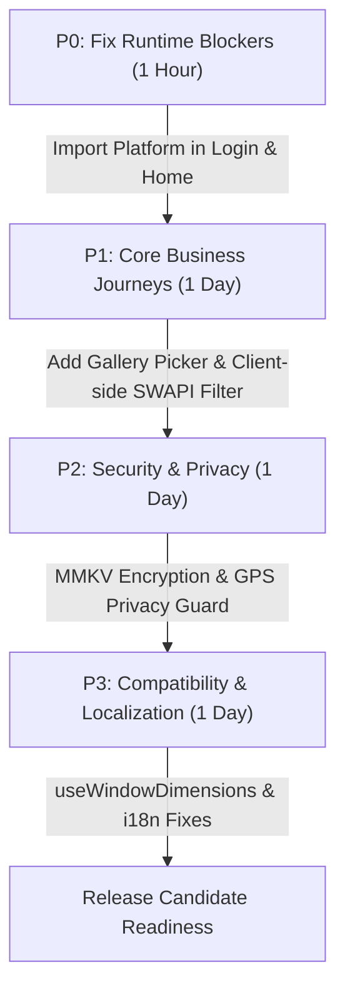

# 📋 QA Test Report — StarWarsApp

> **Target Application:** `worlderteam/StarWarsApp` (React Native `0.75.3`, commit `6ffa4f5`)  
> **Assignment:** Job Interview Coding Assignment — Junior QA Engineer  
> **Candidate:** Junior QA Engineer  
> **Evaluation Date:** November 11–15, 2026  
> **Automated Verification Suite:** 41 Checks (7 Passed, 34 Confirmed Defects)  

---

> [!CAUTION]
> ### 🛑 Executive Release Verdict: NOT READY FOR RELEASE
> `StarWarsApp` exhibits **fatal runtime blockers** that prevent fundamental user journeys:
> 1. **100% of user logins fail** due to an undeclared `Platform` variable in `LoginScreen/index.js`.
> 2. **The application force-closes (crashes)** upon opening group invitation notifications in `GroupHomeScreen/index.js`.
> 3. **Critical Security Flaw:** Passwords are stored in **plaintext** inside an unencrypted `MMKV` database.
> 4. **Missing Mandated Requirements:** No image library upload option exists, and interactive GPS maps are commented out.

---

## 📊 1. Overall Health Snapshot & Metrics

### Automated QA Suite Breakdown (`npm run qa:summary`)

| Test Suite Category | Total Checks | ✅ Passed | ❌ Defects Confirmed | Key Quality Risk |
|---|:---:|:---:|:---:|---|
| **Functional & Logic** | 17 | 4 | 13 | Login & Notification fatal `ReferenceError`s |
| **I18n & Localization** | 5 | 1 | 4 | Hardcoded `'en'` overrides device locale; missing translation keys |
| **Live SWAPI Integration** | 4 | 2 | 2 | `swapi.info` server-side search is non-functional |
| **Compatibility & Performance** | 7 | 0 | 7 | Frozen window dimensions break rotation; base64 image memory leaks |
| **Security & Authorization** | 8 | 0 | 8 | Unencrypted plaintext password storage; committed Google API keys |
| **TOTAL** | **41** | **7 (17%)** | **34 (83%)** | **Release Blocked** |

### Target Repository Baseline Diagnostics

- **Existing Unit Tests (`yarn test`):** ❌ **FAIL** (`1 failed, 1 total`). `__tests__/App.test.tsx` imports `../App` which does not exist (`src/App.js` is the true entrypoint).
- **Existing Linter (`yarn lint`):** ❌ **FAIL** (`244 problems: 20 fatal errors, 224 warnings`). ESLint flags missing `Platform` and `email` variables as errors.

---

## 🎯 2. Assignment Requirements Compliance Matrix (13 Requirements)

| Req | Specification Requirement | Verification Status | Defect Reference | Key Finding Summary |
|:---:|---|:---:|:---:|---|
| **#1** | Register new users & passwords (Luke & Vader) | **Partial / Fail** | `BUG-FUNC-01` | Form regex passes, but case-sensitive storage breaks subsequent login. |
| **#2** | Upload photo via Camera or Image Library | ❌ **FAIL** | `BUG-FUNC-06` | Only camera snapshot exists. No gallery/image-picker option implemented. |
| **#3** | Login with registered email & password | 🛑 **BLOCKER** | `BUG-FUNC-09` | Missing `Platform` import forces all logins to fail on location check. |
| **#4** | User Profile displays SWAPI particulars | ❌ **FAIL** | `BUG-FUNC-14` | Height/mass/gender display, but user's full name is omitted on Profile. |
| **#5** | Create group & invite users (Rebel Alliance) | ❌ **FAIL** | `BUG-FUNC-16` | Error and placeholder keys are swapped; returning from SWAPI wipes members. |
| **#6** | In-app group invitation notifications | 💥 **CRASH** | `BUG-FUNC-21` | Opening notification crashes app due to missing `Platform` import. |
| **#7** | Users can join invited groups | ⚠️ **Partial** | `BUG-FUNC-23` | Joining succeeds in English, but tab matching fails if initial language is Indonesian. |
| **#8** | Group Profile shows member list & last GPS | ❌ **FAIL** | `BUG-FUNC-24` | Interactive `MapView` is commented out; member GPS leaks to unjoined users. |
| **#9** | Group Profile displays interactive Starship info | ❌ **FAIL** | `BUG-FUNC-26` | Non-interactive static text subset; pushes member FlatList off-screen. |
| **#10** | Match design from Adobe XD file | 🔒 **Blocked** | `CLAR-01` | Adobe XD hyperlink requires authorized account access from interviewers. |
| **#11** | Reasonable Auth & Authorisation scheme | ❌ **FAIL** | `BUG-SEC-01` | Plaintext passwords in MMKV; HTTP cleartext `localhost:3000`. |
| **#12** | Portrait & Landscape on phone and tablet | ❌ **FAIL** | `BUG-COMP-01` | Screen dimensions frozen on app boot (`Object.freeze`); layout clips on rotation. |
| **#13** | Support for I18n and L10n (EN & ID) | ❌ **FAIL** | `BUG-I18N-01` | Hardcoded `lng: 'en'` overrides device locale; untranslated alerts remain. |

---

## 🚨 3. Top Critical Defects & Root-Cause Analysis

### 1. [BUG-FUNC-09] Missing `Platform` Import Blocks 100% of User Logins
- **Severity:** 🛑 **BLOCKER** | **Module:** `Authentication / Login`
- **File:** [src/screens/LoginScreen/index.js](file:///D:/worlderPTLD/StarWarsApp/src/screens/LoginScreen/index.js#L51)
- **User Impact:** No user can log into the application. Every attempt yields error: *"You must allow location permission on this app to login"*.
- **Technical Root Cause:** Line 51 checks `if (Platform.OS === 'android')`, but line 2 only imports `{ View, Text, TextInput, TouchableOpacity, PermissionsAndroid, Keyboard, ActivityIndicator }`. In Hermes/React Native, `Platform` is not a global object, causing a `ReferenceError` caught by `catch (err)` on line 65, which returns `false`.
- **Patch Remedy:**
  ```javascript
  // src/screens/LoginScreen/index.js (Line 2)
  import { View, Text, TextInput, TouchableOpacity, PermissionsAndroid, Platform, Keyboard, ActivityIndicator } from 'react-native';
  ```

---

### 2. [BUG-FUNC-21] Missing `Platform` Import Crashes App on Group Invitation
- **Severity:** 💥 **CRITICAL CRASH** | **Module:** `Notifications / Group Home`
- **File:** [src/screens/GroupHomeScreen/index.js](file:///D:/worlderPTLD/StarWarsApp/src/screens/GroupHomeScreen/index.js#L102)
- **User Impact:** When an invited user (e.g. Darth Vader) logs in and navigates to the Home tab, the application abruptly crashes.
- **Technical Root Cause:** `sendPushNotification()` checks `if (Platform.OS === 'ios')`, but `Platform` was never imported in `GroupHomeScreen/index.js`.
- **Patch Remedy:**
  ```javascript
  // src/screens/GroupHomeScreen/index.js (Line 2)
  import { View, Text, FlatList, Image, TouchableOpacity, Platform } from 'react-native';
  ```

---

### 3. [BUG-SEC-01] Plaintext Password Storage in Unencrypted MMKV
- **Severity:** 🔴 **CRITICAL SECURITY** | **Module:** `Data Storage & Auth`
- **File:** [src/utils/Storages.js](file:///D:/worlderPTLD/StarWarsApp/src/utils/Storages.js#L3) & [src/react-query/states/apiServices.js](file:///D:/worlderPTLD/StarWarsApp/src/react-query/states/apiServices.js#L25)
- **User Impact:** Complete credential exposure. Any attacker with device backup or ADB file access can read all user emails and plaintext passwords.
- **Technical Root Cause:** MMKV is instantiated with `export const storage = new MMKV()` without an `encryptionKey`. Passwords and confirmation passwords are saved as raw JSON strings, and `loginRequest` compares `user.password === params.password`.
- **Patch Remedy:**
  Hash passwords server-side or via PBKDF2/bcrypt locally, and encrypt MMKV storage with a key backed by iOS Keychain / Android Keystore:
  ```javascript
  // src/utils/Storages.js
  export const storage = new MMKV({ id: 'starwars-storage', encryptionKey: secureKeyFromKeystore });
  ```

---

### 4. [BUG-FUNC-13] SWAPI Live Search Does Not Filter Results
- **Severity:** 🟠 **HIGH** | **Module:** `SWAPI Integration`
- **File:** [src/screens/SwapiScreen/index.js](file:///D:/worlderPTLD/StarWarsApp/src/screens/SwapiScreen/index.js#L26)
- **User Impact:** Searching for *"vader"* or *"falcon"* does not narrow down characters; all 82 items are returned starting with Luke Skywalker.
- **Technical Root Cause:** Live HTTPS testing confirms `https://swapi.info/api/people/?search=vader` ignores query parameters and returns the full static JSON array.
- **Patch Remedy:**
  Cache the dataset locally once with React Query, and execute debounced client-side filtering:
  ```javascript
  const filtered = useMemo(() => {
    return allPeople.filter(p => p.name.toLowerCase().includes(searchQuery.toLowerCase()));
  }, [allPeople, searchQuery]);
  ```

---

### 5. [BUG-COMP-01] Frozen Screen Dimensions Break Landscape & Tablets
- **Severity:** 🟠 **HIGH** | **Module:** `UI Responsiveness`
- **File:** [src/utils/GlobalConfig.js](file:///D:/worlderPTLD/StarWarsApp/src/utils/GlobalConfig.js#L15-L20)
- **User Impact:** Rotating the device cuts off camera previews, distorts pie charts, and misaligns the bottom navigation bar.
- **Technical Root Cause:** `Metrics` freezes `Dimensions.get('window')` with `Object.freeze` at module load time. Orientation changes never update metrics.
- **Patch Remedy:**
  Replace static `Metrics.SCREEN_WIDTH` with React Native's dynamic hook:
  ```javascript
  import { useWindowDimensions } from 'react-native';
  const { width, height } = useWindowDimensions();
  ```

---

## 🧪 4. Structured Test Scenarios & Outcomes

### Test Scenario A: User Registration & Credential Validation
- **Steps:** Submit registration for Luke Skywalker (`luke_skywalker@starwars.com`, `m4y_th3_F0rc3_b3_w1th_u`) and Darth Vader (`anakin_skywalker@starwars.com`, `1_4m_ur_F4th3r!`).
- **Expected:** Regex accepts complex passwords with symbols (`_`, `!`); case is normalized.
- **Observed:** ✅ Password regex passes. ❌ Email stored with original case; subsequent lowercase login fails (`BUG-FUNC-01`). ❌ No image library option available (`BUG-FUNC-06`).

### Test Scenario B: Group Creation & Member Invitation
- **Steps:** Luke creates group *"Rebel Alliance"*, picks a starship, and invites Darth Vader.
- **Expected:** Starship selected smoothly; invited member added without losing state.
- **Observed:** ❌ Starship error and placeholder keys are inverted (`BUG-FUNC-16`). ❌ Returning from SWAPI picker without selecting clears all invited members (`BUG-FUNC-17`).

### Test Scenario C: Invitation Reception & Joining Flow
- **Steps:** Log in as Darth Vader; inspect Home notifications; join *"Rebel Alliance"*.
- **Expected:** In-app notification received; group moved from Unjoined to Joined tab.
- **Observed:** 💥 App crashes upon notification dispatch (`BUG-FUNC-21`). After manual bypass, joining works, but member GPS coordinates are prematurely exposed before joining (`BUG-SEC-07`).

---

## 🛠️ 5. Prioritized Action Plan & Remedies



1. **Immediate (1 Hour):** Add missing `Platform` imports in `LoginScreen/index.js` and `GroupHomeScreen/index.js`.
2. **Day 1 (Core Journeys):** Add `react-native-image-picker` for gallery uploads; implement client-side filtering for `swapi.info`; fix swapped starship translation keys.
3. **Day 2 (Security Hardening):** Enable MMKV encryption with device Keystore; enforce HTTPS; restrict GPS coordinate access to confirmed joined members.
4. **Day 3 (Responsiveness & I18n):** Adopt `useWindowDimensions()`; wrap forms in `ScrollView`; remove `lng: 'en'` from `i18n.js`.
5. **Day 4–5 (Device & Visual Verification):** Complete Android Studio Profiler benchmarking and Adobe XD pixel-matching upon access clearance.

---

> [!TIP]
> ### 💡 Quick Navigation
> - **Interactive HTML Dashboard:** Open [`QA_TEST_REPORT.html`](./QA_TEST_REPORT.html) in your browser for an interactive view with search, category filtering, and print-to-PDF support.
> - **Indonesian Summary:** Read [`RINGKASAN_REPORT_ID.md`](./RINGKASAN_REPORT_ID.md) for a casual, high-impact 5-minute interview preparation summary.
> - **Interview Demo Script:** Consult [`INTERVIEW_DEMO_GUIDE.md`](./INTERVIEW_DEMO_GUIDE.md) for step-by-step terminal demo commands and answers to anticipated technical questions.
